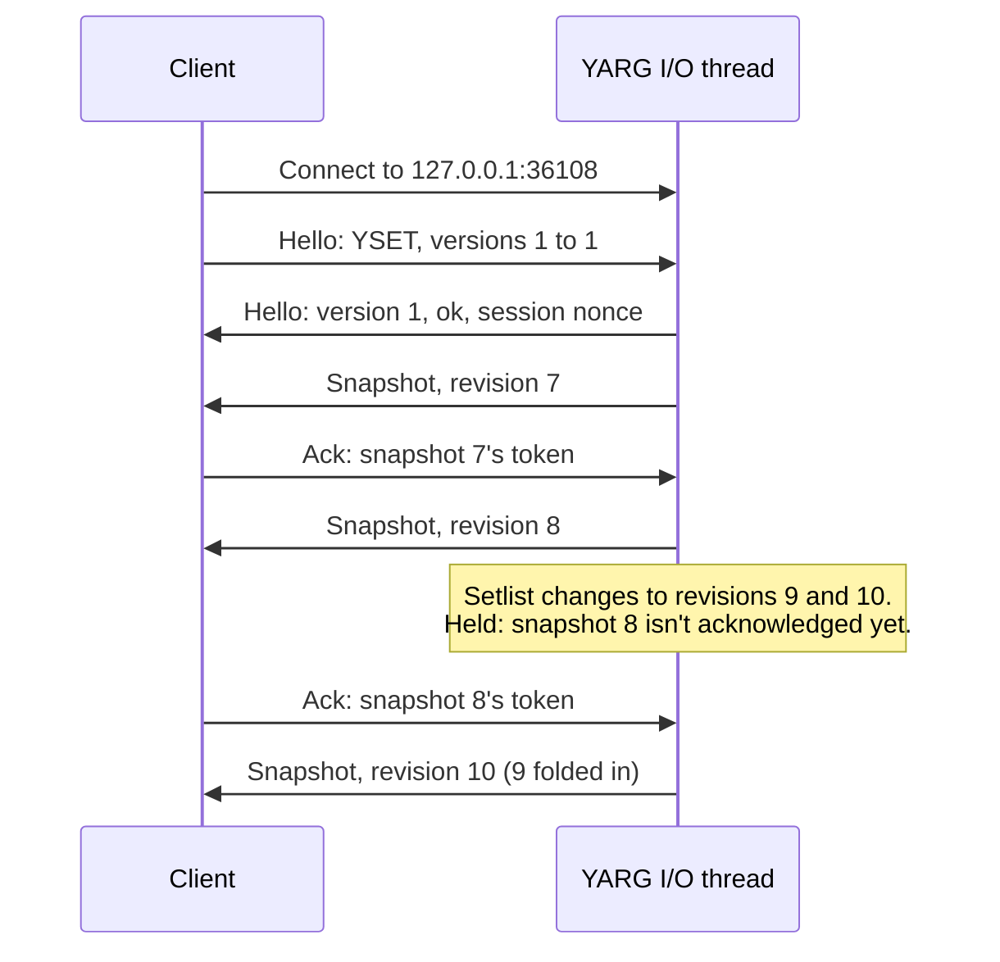

# Setlist Socket Protocol

YARG can push the live setlist to apps on the same computer over a loopback TCP socket. Clients acknowledge what they read, so a client that stops reading never holds up YARG. This is version 1, which is read-only. All integers are little-endian.

The design and the reasons behind it are in [setlist_socket_design.md](setlist_socket_design.md). The code is in [`Integration/Setlist Socket`](../Assets/Script/Integration/Setlist%20Socket).

---

## 1. Connecting

- **Opt-in:** the socket opens only while **Settings > Experimental > Enable setlist socket** is on. It's off by default.
- **Address:** `127.0.0.1` only. Connect to that address, not `localhost`: newer Node versions try `::1` first, and YARG doesn't listen there.
- **Port:** 36108, next to the UDP Data Stream's 36107. If another app holds it, YARG shows a toast and tries again every 10 seconds.
- **Limits:** up to 4 clients at once, plus up to 4 connections still in the handshake. YARG accepts at most 4 new connections per second; the rest wait in a small backlog, and the OS refuses connections once it's full.

---

## 2. Handshake

The client speaks first and must send its whole hello within 2 seconds of connecting, or YARG closes the connection. The magic doesn't start with an HTTP method or with `0x16`, the first byte of a TLS handshake, so a browser's request fails on its first byte.

**Client hello** (8 bytes)

| Field | Type | Value |
| :--- | :--- | :--- |
| magic | 4 bytes | `YSET` (`0x59 0x53 0x45 0x54`) |
| minVersion | u16 | Lowest protocol version the client supports |
| maxVersion | u16 | Highest protocol version the client supports |

**Server hello** (17 bytes)

| Field | Type | Value |
| :--- | :--- | :--- |
| magic | 4 bytes | `YSET` |
| version | u16 | The version YARG chose, or 0 when the status isn't ok |
| status | u8 | 0 ok, 1 no common version, 2 busy |
| sessionNonce | u64 | Random, new each time the socket starts: YARG launching, the setting turning on, or YARG reopening the socket after an internal error. Revisions restart with it. |
| maxClientFrame | u16 | Largest payload a client frame may carry, in bytes (64) |

When the status isn't 0, YARG stops sending, waits up to a second so the client can read the hello, and closes.

---

## 3. Frames

After an ok hello, both sides send frames: a 5-byte header, then the payload.

| Field | Type | Value |
| :--- | :--- | :--- |
| length | u32 | Payload bytes after the header (the type byte isn't counted) |
| type | u8 | Frame type, below |

| Type | Name | Direction | Payload |
| :--- | :--- | :--- | :--- |
| `0x01` | Snapshot | YARG to client | The setlist; see Snapshot |
| `0x02` | Ack | Client to YARG | `u32 token` of the last snapshot the client read; see Flow control |

YARG ignores frame types it doesn't know and Ack payloads that aren't 4 bytes. A frame whose length is larger than `maxClientFrame` closes the connection.

---

## 4. Snapshot

A snapshot is the whole setlist as it stands. YARG sends one right after an ok hello, then a new one after any frame in which the setlist, its state or the song library changed. Clients replace what they have; there are no diffs.

| Field | Type | Value |
| :--- | :--- | :--- |
| state | u8 | 0 inactive, 1 active |
| flags | u8 | Bit 0: a show is in progress. Bit 1: truncated. |
| revision | u32 | Increases with every snapshot, starting at 1. A snapshot follows every setlist change, including each advance to the next song. |
| currentIndex | i32 | Entry being played during a show, otherwise -1 |
| totalCount | u32 | Songs in the setlist, including any cut by truncation |
| entryCount | u32 | Entries in this frame |
| token | u32 | Random; echo it in an Ack once this frame is read |
| entries | | `entryCount` entries, in setlist order |

**Entry**

| Field | Type | Value |
| :--- | :--- | :--- |
| hash | 20 bytes | The song's hash, as YARG's song cache stores it |
| lengthMs | u32 | Song length in milliseconds |
| title | u16 length + UTF-8 | At most 256 bytes, cut on a character boundary |
| artist | u16 length + UTF-8 | Same |
| album | u16 length + UTF-8 | Same |

**States.** The setlist is active while the music library is open, and through a whole show, from Start Set to the last score screen. Everywhere else it's inactive, including a single song played from the library and its Difficulty Select. An inactive snapshot always carries zero entries, because YARG usually clears the setlist before the player sees it again. The exception is backing out of a single song's Difficulty Select, which brings the same setlist back.

**Missing songs.** Songs the current library can't resolve, such as ones hidden by the content-rating setting, are left out. `currentIndex` counts only the entries sent.

**Truncation.** A snapshot is at most 64 KB. When the setlist doesn't fit, YARG sends the leading entries that do and sets the truncated flag; `totalCount` still gives the full count. A typical entry is about 80 bytes, so this starts around 800 songs. In a truncated snapshot, `currentIndex` can point past the last entry sent.

---

## 5. Flow control

YARG doesn't send a client another snapshot until the client has acknowledged reading the previous one. Changes made in the meantime are folded into a single newer snapshot, sent as soon as the ack arrives.

- Every snapshot carries a fresh random `u32` token, and an ack echoes the token of the last snapshot the client read. A client can only learn a token by reading its frame, so it can't acknowledge data it never read.
- Send an ack after each snapshot. YARG remembers the tokens of the last 32 frames it sent each client; an ack naming an older or unknown token is ignored.

This is what keeps a stuck client from holding up YARG. All socket I/O runs on one background thread, and Mono's `Send` doesn't return until every byte has been handed to the OS, even on a non-blocking socket. With at most one unacknowledged snapshot of at most 64 KB per client, and a 256 KB send buffer, every send fits at once and never waits.

A client that hasn't acknowledged within 10 seconds, while a newer snapshot is waiting for it, is disconnected.

---

## 6. Closing and errors

YARG closes a connection when:

- the hello is wrong, or doesn't arrive within 2 seconds
- there's no common version, or all client slots are full (after sending the status)
- a frame's length is larger than `maxClientFrame`
- an ack is 10 seconds late while a newer snapshot is waiting
- a send fails
- the socket stops after an internal error; YARG opens it again 10 seconds later, with a new session nonce
- the player turns the setting off, or quits

A client that reconnects gets the current snapshot straight away, so reconnecting is always a safe way to recover. When the session nonce in the new hello differs from the last one, the socket has restarted and revisions start over.

---

## 7. Versioning

The client offers a range of versions and YARG picks the highest one both support, so a newer client can still talk to an older YARG. A change to any layout in this document means a new version.
