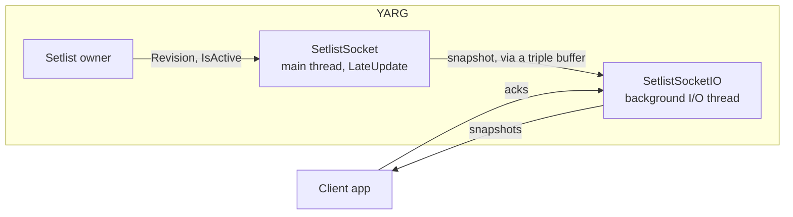

# Setlist Socket Design

Local apps can follow YARG's setlist over a loopback socket. There's no web server and no steady-state garbage, socket I/O stays off the main thread, and the main thread's work is bounded each frame. The wire format is in [setlist_socket.md](setlist_socket.md).

---

## 1. Problem

People running YARG at parties want guests to queue songs from their phones ([#860](https://github.com/YARC-Official/YARG/issues/860), [#1715](https://github.com/YARC-Official/YARG/issues/1715)), and streamers want overlays that show what's up next. Today the only way for an outside app to touch the setlist is a BepInEx plugin that reads YARG's internals, which breaks whenever YARG renames something. A small supported contract lets any tool build on it across YARG versions.

---

## 2. Constraints

- **No web server in the game.** Background work during gameplay must not add GC pressure, so the transport is a small loopback socket speaking a custom protocol over plain TCP.
- **No steady-state garbage.** Every connection slot gets fixed buffers when the socket starts, snapshots are encoded into reused buffers, and nothing allocates per frame or per message once a client is connected.
- **Bounded main-thread work.** Socket I/O runs on one background thread, like the UDP Data Stream's, so a stalled client can't freeze the game. Clients acknowledge each snapshot before they get the next, so one that stops reading can't hold up the others.
- **Same machine only.** YARG listens on `127.0.0.1` only, on fixed port 36108, so other devices can't connect. A handshake rejects anything that isn't a setlist client, such as a browser request. There's no token, because most programs that can reach loopback could edit YARG's files directly anyway. Phones reach YARG through a companion app running on the same PC.
- **Opt-in.** The socket opens only while its setting is on, and it's off by default.
- **Stable contract.** The handshake negotiates a protocol version, so clients and YARG can change independently.

---

## 3. How it works

- [`Setlist`](../Assets/Script/Playlists/Setlist.cs) owns the live setlist. `Setlist.IsActive` says whether outside apps may see it (section 4).
- [`SetlistSocket`](../Assets/Script/Integration/Setlist%20Socket/SetlistSocket.cs) is a component on the persistent `GlobalVariables` object. Each `LateUpdate` it compares `Setlist.Revision`, `Setlist.IsActive` and `SongContainer.LibraryRevision` with what it last published (a rescan can stop songs resolving without touching the setlist). Only on a change does it copy each entry's hash, length and title/artist/album references into a preallocated snapshot and hand it over through a triple buffer, so neither thread waits for the other.
- It polls the setting each frame instead of using a settings callback, so startup ordering and the callback pass during settings load can't start the socket twice. `OnDisable` stops it, which also covers editor script reloads.
- [`SetlistSocketIO`](../Assets/Script/Integration/Setlist%20Socket/SetlistSocketIO.cs) owns the listener, every client and one background thread. It encodes each new snapshot once and sends it to each client that has acknowledged the last one. It never touches `SongEntry` or the library.
- [`SetlistProtocol`](../Assets/Script/Integration/Setlist%20Socket/SetlistProtocol.cs) reads and writes the frames. Nothing in it allocates.

**Stopping** never joins the thread. `Stop` closes the listener from the main thread, which frees the port at once, and the thread closes its clients and exits on its own. A restart creates a new instance, so the two never share buffers. If the thread stops on an unexpected error, it closes the listener and `SetlistSocket` starts a new one 10 seconds later.

---

## 4. When the setlist is active

The setlist exists only while the music library is open and during a show. Leaving the library clears it, and every load of the menu scene resets it, including after a show ends and after a single song played from the library. So every snapshot says whether the setlist is active:

| State | When | What clients see |
| :--- | :--- | :--- |
| `active` | The music library is the open menu, or a show is in progress, from Start Set through the last score screen | The setlist |
| `inactive` | Everywhere else, such as the main menu, career, practice, replays, and a single song including its Difficulty Select | An empty setlist |

`MenuManager` reports the top of its menu stack after every push and pop, rather than the library reporting its own `OnEnable`/`OnDisable`, because `ReactivateCurrentMenu` turns the library off for a frame and back on, which would flash inactive. Start Set marks the show as playing before it opens Difficulty Select, so a show never passes through an inactive gap.

---

## 5. Garbage and main-thread cost

- **Per frame, nothing changed:** four comparisons against the last published values.
- **Per frame, something changed:** the setlist is resolved into a reused list and each entry's fields are copied by reference into the snapshot. That's linear in the setlist's length, and it happens only on the frame of a change.
- **Socket thread:** each snapshot is encoded once into a reused 64 KB buffer and sent to each ready client. UTF-8 encoding is hand-written, because `Encoding.UTF8.GetBytes` throws when the destination is too small and allocates a fallback buffer for lone surrogates. Ack tokens come from a `RandomNumberGenerator` that refills a reused buffer 64 tokens at a time.
- **Measured** on the Mono 6.13 runtime that ships with Unity 6000.3.5f2: with an external client acknowledging 2,000 snapshots of about 13 KB, the heap grew by a one-off 2.9 KB, the main thread allocated 32 bytes, and no gen0 collections ran.

---

## 6. Why acks instead of non-blocking sockets

Mono's `Socket.Send` doesn't return until every byte has been handed to the OS. That holds on non-blocking sockets too: on Unity's Mono 6.13 on Windows, a non-blocking `Send` to a client that stopped reading doesn't return a short count or `WouldBlock`, it spins at 100% CPU until the client reads again. The `IList<ArraySegment<byte>>` overload does return `WouldBlock`, but allocates 48 bytes per call.

So the socket thread never sends more than fits in the kernel's send buffer. Each snapshot carries a random token, and a client acknowledges a snapshot by echoing its token, which it can only learn by reading the frame. With at most one unacknowledged snapshot of at most 64 KB per client and a 256 KB send buffer, every send fits at once and never waits. Changes made while a client hasn't acknowledged are folded into the next snapshot.

---

## 7. Alternatives considered

| Option | Why it ranks lower |
| :--- | :--- |
| Files in YARG's data folder: a state file plus a command folder | No listener, and the files are easy to inspect. A polling reader can get close to garbage-free too. But clients have to watch or poll for changes, failures leave files behind, and updates can't be pushed. |
| A full HTTP server on localhost ([#984](https://github.com/YARC-Official/YARG/pull/984)) | It allocates on every request, on thread-pool threads YARG doesn't control. Browsers can reach it, so it needs defenses against DNS rebinding and cross-site requests. |
| WebSocket framing on the same socket | Overlays and browser sources could connect directly, and standard tools could inspect it. But YARG would carry the RFC 6455 must-haves (opening handshake, masking, fragmentation, close, ping/pong), would have to check `Host` and `Origin` because browsers can connect, and the handshake allocates for SHA-1 and Base64. It can be added later if direct browser access matters. |
| Named pipe or Unix socket | The same tradeoffs as loopback TCP, plus behavior to check on every platform under Mono, and browsers can't use it either. |
| Clients edit playlist JSON directly, and YARG reloads it | YARG and the client both rewrite the whole file, so whoever writes last wins. |
| Leave it to BepInEx plugins | That's how it works today. It breaks whenever YARG renames something, and it isn't supported. |

Out of scope: players and profiles, access over the LAN, a new "up next" queue separate from the setlist, and library browsing. Clients find songs through the manual song export or `songcache.bin`, so a supported library listing is a natural follow-up.

---

## 8. Next: commands

This version is read-only. The next step lets clients add, remove, move and clear songs over the same connection. Commands will name setlist entries by stable IDs rather than positions, so the show advancing or two people editing at once can't make a song land in the wrong place, and the main thread will apply a few per frame, only while the setlist is active.
